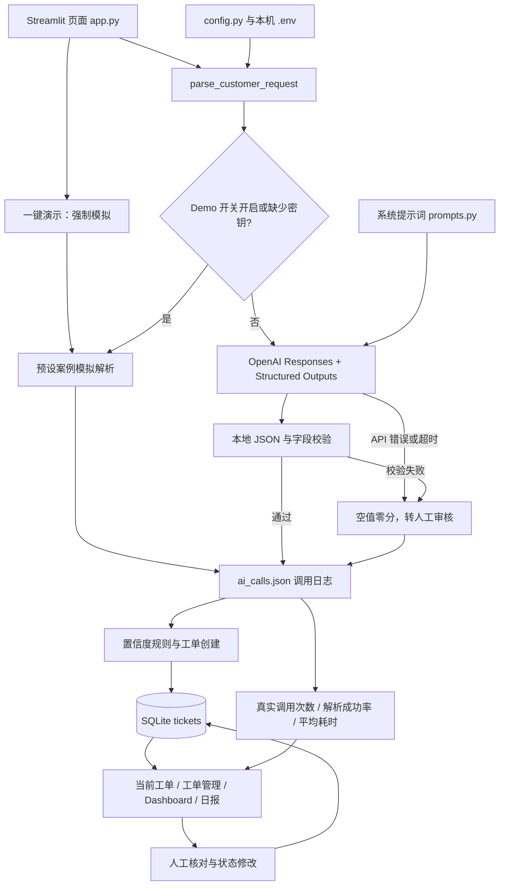

# AutoFlow AI

智能服务工单与运营自动化系统，使用 Python + Streamlit，按 MVP 的规模组织。
当前提供 OpenAI 需求解析与逐字段自评分、工单创建、业务规则、人工审核、SQLite 持久化、运营管理、日报和数据看板。
首页提供五张模块说明卡、一键演示与逐步流程展示；侧边栏提供独立的项目介绍页，便于讲解系统结构。
默认使用不联网的 Demo 模式。在 `config.py` 设置 `DEMO_MODE=False` 并配置 API Key 后，可调用真实模型。
缺少密钥时自动使用模拟解析；真实 API、超时或解析错误会降级为人工审核工单，保留客户原文。
工单保存到本地数据库，刷新或重启后可查看历史记录、调用次数与响应时间。
空库可加载 120 条最近 30 天的模拟业务数据；看板增加完成率、AI 自动处理率、状态饼图和新增趋势折线图。

## 项目介绍与功能列表

企业客服的自然语言需求需要整理为服务类型、预约时间、地址和联系方式等字段。
AutoFlow AI 将解析、规则检查、人工审核和运营统计组织成一个可演示的 MVP，保留原始需求与解析快照，方便核对和追踪。

- 需求解析：固定 Demo 案例与真实 OpenAI Structured Outputs 两种模式，调用失败时转人工审核。
- 工单管理：自动编号、SQLite 保存、历史查询、人工字段修正和状态更新。
- 规则审核：检查四个关键字段及 0.7 置信度阈值，禁止通过普通改状态绕过待审工单。
- 运营分析：日报、完成率、规则自动通过率、服务与状态分布、最近 30 天新增趋势。
- 面试演示：一键演示五步流程、空库加载 120 条虚构数据、独立项目介绍页面。
- 调用记录：安全错误描述、请求时标、模型、token 与耗时；客户输入输出日志保留在运行环境，排除 Git。

默认仅使用虚构数据演示。当前没有登录和访问控制；真实客户业务还需要受控访问、数据备份和调用额度管理。

## 项目结构

```text
AutoFlow_AI/
├── app.py                    # Streamlit 入口
├── config.py                 # Demo 模式开关与预设案例
├── pages/
│   └── 项目介绍.py           # Streamlit 原生多页面的只读项目介绍
├── modules/                  # 业务模块
│   ├── __init__.py
│   ├── ai_parser.py          # Structured Outputs 解析与失败降级
│   ├── prompts.py            # AI 系统提示词
│   ├── ai_logging.py         # 调用日志与 AI 指标统计
│   ├── tickets.py            # 工单管理
│   ├── rules.py              # 业务规则判断
│   ├── automation.py         # 运营日报统计
│   ├── analytics.py          # 运营指标、处理率与最近 30 天趋势
│   └── dashboard.py          # KPI、状态分布和服务类型统计
├── database/                 # 数据库代码
│   ├── __init__.py
│   ├── db.py                 # SQLite 连接、建表与 SQL
│   └── seed.py               # 空库演示数据生成与事务加载
├── data/                     # 运行时数据
│   ├── .gitkeep              # 保留目录
│   └── autoflow.db           # 启动或保存时自动生成的 SQLite 数据库
├── logs/
│   ├── .gitkeep              # 上传空目录占位文件
│   └── ai_calls.json         # AI 调用记录，初始为空数组，排除版本管理
├── tests/
│   ├── test_ai_parser.py     # 不联网的解析与异常回归测试
│   ├── test_ai_logging.py    # 日志写入、并发与 AI 指标测试
│   ├── test_ai_pipeline.py   # API 降级、保存与页面审核流程测试
│   ├── test_demo.py          # 模式选择、启动提示和案例按钮测试
│   ├── test_interview_demo.py # 一键演示、流程展示与项目介绍页测试
│   ├── test_db.py            # 临时数据库的持久化与状态更新测试
│   ├── test_automation.py    # 日报统计与北京时间日期边界测试
│   ├── test_ticket_management.py # 工单管理页面交互与保存测试
│   ├── test_dashboard.py     # 看板统计与页面更新测试
│   ├── test_analytics.py     # 运营分析、加载事务与三种图表测试
│   └── test_confidence.py    # 置信度与完整人工审核流程测试
├── .env.example             # 环境变量模板，不包含真实密钥
├── requirements.txt          # 第三方依赖
├── .gitignore                # 排除环境、密钥和运行数据
├── LICENSE                   # MIT 开源许可证
└── README.md                 # 结构、启动方式与开发顺序
```

这是源码及运行数据的位置说明；`data/autoflow.db`、调用日志和本地虚拟环境不上传。
`data/` 与 `logs/` 只提交 `.gitkeep`，运行时自动创建数据库与日志。
本地原文备份 `docs/original_app.py.txt` 继续保留，但已排除版本控制和上传。

## 文件职责

| 文件 | 作用 |
| --- | --- |
| `app.py` | 展示标题、五张模块说明卡和系统状态；处理普通创建与一键模拟演示，展示五步流程、工单管理、数据看板和日报。 |
| `config.py` | `DEMO_MODE=True/False` 控制演示或真实模式；统一保存 Demo 案例文本，不包含密钥。 |
| `pages/项目介绍.py` | 独立的只读项目介绍页，通过 Streamlit 原生多页面侧边栏打开；介绍项目目标、模块分工、流程与当前边界，不创建工单或调用模型。 |
| `modules/__init__.py` | 将目录标记为 Python 包，不在这里执行任务。 |
| `modules/ai_parser.py` | `parse_customer_request(text)` 按模式选择模拟或严格 JSON Schema 的真实 SDK 解析；`parse_demo_request(text)` 始终使用模拟解析供一键演示调用。提供无网络启动检查，真实调用失败时返回零分空值供人工审核。 |
| `modules/prompts.py` | 集中管理系统提示词，界面不包含提取逻辑。 |
| `modules/ai_logging.py` | 写入 JSON 调用日志，统计真实 SDK 尝试次数、解析成功次数、成功率和已测量耗时；使用线程锁与临时文件替换，写入失败不覆盖原日志。 |
| `modules/tickets.py` | 创建工单并保存原 AI 解析快照、审核标记、token 数和耗时；提供 `review_ticket` 保存人工修正，保留原 AI 信息。旧的无分数字典输入仍兼容。 |
| `modules/rules.py` | `check_confidence` 判断四个关键字段是否需要审核；`get_confidence_score` 取关键字段最低分；原 `check_ticket_status` 信息缺失规则继续保留。 |
| `modules/automation.py` | `generate_daily_report()` 读取数据库，返回累计数量和今日新增工单的当前状态统计，不调用 AI 或修改工单。 |
| `modules/analytics.py` | `get_operational_metrics()` 读取工单，返回当前状态数量、原始 AI 规则通过数量、平均工单解析耗时、处理率及最近 30 天新增趋势。 |
| `modules/dashboard.py` | `get_dashboard_stats()` 汇总工单与调用日志，返回工单分布、当前待审核数量、AI 调用次数、解析成功率和平均响应时间；日志读取失败仍可展示工单统计。 |
| `database/__init__.py` | 将数据库访问目录标记为 Python 包。 |
| `database/db.py` | SQLite 初始化及旧表增列迁移，保存、查询、状态更新与人工审核结果写入。审核中工单不能通过普通改状态绕过审核。 |
| `database/seed.py` | 默认生成 120 条虚构工单；事务内检查空库并一次加载，支持重复或并发调用，不覆盖现有工单，不调用模型或写入 API 日志。 |
| `data/.gitkeep` | 保留运行数据目录，运行时生成 `data/autoflow.db`。 |
| `logs/ai_calls.json` | 保存客户输入、结构化输出、时间、结果和安全错误描述，以及调用指标。包含客户数据，不提交到版本管理。 |
| `logs/.gitkeep` | 保留空日志目录，运行日志不提交。 |
| `requirements.txt` | 固定 Streamlit、OpenAI、python-dotenv、pandas 和 matplotlib 版本；当前页面继续使用原生图表。 |
| `LICENSE` | MIT 许可证，版权署名为 AutoFlow AI contributors，不含个人身份信息。 |
| `.env.example` | 配置模板，说明调用真实模型所需的 `OPENAI_API_KEY` 和可选的 `OPENAI_MODEL`。 |
| `tests/test_ai_parser.py` | 离线检查正常解析、异常响应、密钥缺失及已有工单状态流程；模拟模型调用和数据库写入。 |
| `tests/test_ai_logging.py` | 使用临时日志检查安全追加、线程并发、坏日志保护与调用统计口径。 |
| `tests/test_ai_pipeline.py` | 使用模拟 SDK、临时数据库和 Streamlit 页面测试验证 API 成功、失败、坏 JSON、缺密钥、日志失败和完整人工审核流程。 |
| `tests/test_demo.py` | 验证 Demo 模式、缺密钥回退、案例填入、重复操作无副作用和人工审核展示。 |
| `tests/test_interview_demo.py` | 使用模拟解析及临时数据检查一键演示、五步展示、重复执行保护、保存失败提示及项目介绍页。 |
| `tests/test_db.py` | 在临时数据库检查表结构、完整保存、重新打开、状态更新、参数化 SQL 和失败处理。 |
| `tests/test_automation.py` | 使用固定日期与临时数据库检查各状态计数、跨日筛选、时区边界及更新后的统计。 |
| `tests/test_ticket_management.py` | 在临时数据库检查全部工单展示、六种状态保存、当前工单和日报同步、重启保留、失败提示与 AI 调用次数。 |
| `tests/test_dashboard.py` | 使用临时数据库检查看板计数、时区边界、未识别服务、图表创建，以及新增工单和状态更新后的 KPI。 |
| `tests/test_analytics.py` | 验证运营统计、审核后自动通过口径、30 天日期边界、数据覆盖、重复与并发加载、事务回滚和页面加载入口。 |
| `tests/test_confidence.py` | 检查高低分、0.7 边界、四个关键字段、审核标记保存、人工修正、阻止绕审及页面审核交互。 |
| `.gitignore` | 排除虚拟环境、Python 缓存、密钥、数据库及客户输入输出日志。 |
| `README.md` | 说明项目结构、文件职责、启动方式和开发顺序。 |

解析、工单、规则、数据库、运营日报与看板模块已有基础实现。
未识别的业务字段使用空字符串，每次点击创建会生成一个新编号。
创建流程为：`输入需求 → 选择模拟/真实解析（真实失败返回空值零分）→ 记录调用日志 → 检查关键字段置信度 → 创建工单及审核标记 → SQLite 保存 → 展示当前工单、管理列表、看板和日报`。
一键演示流程为：`填入预设案例 → 强制模拟解析 → 原规则判断 → 保存一条工单 → 展示解析、分数、规则、工单和当前状态五个步骤`。
运营流程为：`选择工单 → 选择目标状态 → 保存状态 → update_ticket_status → SQLite 提交 → 刷新当前工单、管理列表、看板与日报`。
规则由 `create_ticket` 在填入解析字段后调用一次，解析结果不能覆盖工单编号、原始需求和状态。
手机号、地址的 `None`、空字符串、纯空白字符串或缺失字段都视为空；此规则只判断是否缺失，不验证格式。
新 AI 工单中，四个关键字段均有值且分数不低于 0.7 时为“待确认”，否则进入“人工审核”。
旧的无分数字典输入仍按原手机号/地址规则创建，可信度标记为未记录，不伪造历史分数。
存储调用关系为：`app.py → modules/tickets.py → database/db.py → data/autoflow.db`。
业务模块不要反向导入 `app.py`，避免界面与业务逻辑耦合。

## 项目架构与 AI 调用流程



启动检查只读取配置，不发起付费请求。页面的“GPT实时解析”表示真实 API 路由已启用，
不代表密钥有效或网络已连通；真实可用性须以一次成功调用为依据。
Demo 与真实解析使用相同六字段结构、规则、保存和审核流程；模拟解析不计入真实 AI 调用指标。
一键演示始终走模拟分支，即使普通创建已配置真实模式，也不会通过这个按钮调用 SDK 或访问模型服务。

## 首页与项目介绍页

首页主标题为“AutoFlow AI”，副标题为“智能服务工单与运营自动化系统”。
五张模块说明卡依次为“AI需求解析”“工单自动生成”“业务规则判断”“人工审核机制”“运营数据分析”。
当前系统状态继续显示普通“创建工单”操作采用的模拟或真实路由；一键演示单独标明使用模拟数据。

项目介绍页位于 `pages/项目介绍.py`，使用 Streamlit 原生多页面机制，从侧边栏的“项目介绍”进入。
该页只展示项目背景、模块分工、架构与处理流程，适合先介绍整体方案或在演示结束后回顾设计。
打开该页不会触发模型请求、创建工单或修改已有工单。

系统希望辅助整理客户需求、发现缺失信息并集中查看运营状态；这些是设计目标。
当前没有经过真实业务对照验证的效率、准确率或收益数据，介绍项目时不将演示结果作为实际效果证明。

## SQLite 数据库

数据库路径固定为项目根目录的 `data/autoflow.db`，不依赖启动时的工作目录。
使用 Python 内置 SQLite，无需新增第三方依赖或数据库服务。

`tickets` 表共十四列：原十二个 `TEXT` 字段，加上 `token_used INTEGER` 和 `response_time REAL`：

| 字段 | 含义 |
| --- | --- |
| `id` | UUID 工单编号，非空主键，不允许重复。 |
| `customer_input` | 客户原始需求，非空。 |
| `service_type` | 服务类型，未识别时为空字符串。 |
| `appointment_time` | 预约时间原文，未识别时为空字符串。 |
| `address` | 服务地址，未识别时为空字符串。 |
| `customer_name` | 客户姓名，未识别时为空字符串。 |
| `phone` | 电话号码，按文本保存以保留格式。 |
| `urgency` | 紧急程度，未识别时为空字符串。 |
| `status` | 规则判断后的状态，非空。 |
| `created_time` | 创建时间，非空，ISO 8601 格式，带北京时间 `+08:00` 时区。 |
| `confidence_score` | 原 AI 六字段 `value/confidence` 结果的完整 JSON 文本；历史记录默认为 `{}`。 |
| `review_required` | 库内存为文本 `true/false`，Python 查询返回布尔值；表示当前是否有待完成的人工审核。 |
| `token_used` | SDK 返回的 `usage.total_tokens`，非负整数，默认 `0`。没有用量数据时也为零，不表示已确认免费。 |
| `response_time` | 本次 SDK 请求的测量耗时，单位秒；无调用或历史无记录时为 `NULL`。包含失败请求的测量时间。 |

初始化会检测旧表并用 `ALTER TABLE` 补齐缺少的置信度、审核和调用指标列，不重建表或清空数据。迁移可重复运行。
历史工单的原字段、状态和创建时间保留，原来没有分数的工单显示“未记录”，不会自动补上高分。
历史工单的 token 默认为零、耗时为空；人工审核及普通状态更新保留原调用指标。

`init_db()` 可重复调用，不会删除已有数据。`save_ticket(ticket)` 插入并提交记录，重复编号会报错，不覆盖已有工单。
`get_all_tickets()` 返回字典列表，按创建时间从新到旧排列；同一时间时按插入顺序从新到旧排列。
`update_ticket_status(ticket_id, status)` 更新单个工单，成功返回 `True`，编号不存在时返回 `False`，空状态会被拒绝。
普通状态更新可通过页面“工单管理”表单或 Python 函数调用。
设置“人工审核”会同时打开审核标记；待审工单调用普通状态更新会被拒绝，需通过审核流程处理。

数据库初始化失败时页面停止处理，避免先调用 AI 再发现数据库无法使用。
写入失败时不展示创建成功，读取历史失败时显示提示。每次加载页面都重新查询历史，不因页面重跑重复保存工单。

## 工单运营管理

原历史列表在“工单管理”区域展示全部数据库工单，按创建时间从新到旧排列。
表格包含：工单编号、服务类型、地址、客户姓名、电话、当前状态和创建时间。

选择工单后，页面显示其当前状态，并提供以下目标状态：

- 待补充信息
- 待确认
- 待派单
- 服务中
- 已完成
- 异常
- 人工审核

选好目标状态后点击“保存状态”，才会写入 SQLite。切换工单时，目标状态会恢复为该工单的当前状态；
已有历史状态不在选项中时，需要明确选择目标状态。
成功后自动刷新页面，管理列表、当前会话中的对应工单和日报同步更新；刷新或重启应用后状态仍保留。
未改变状态时不重复写入；数据库保存失败或工单不存在时显示提示，不声称保存成功。

普通状态修改不调用 AI、不创建新工单，也不重新运行创建时的字段规则。
待审工单显示字段核对表单，审核完成后恢复普通状态修改，不增加登录或复杂权限。

手动检查方法：

1. 启动页面；无工单时应显示空记录提示，有工单时应显示七个表格字段。
2. 选择一条工单，将状态改为“待派单”或“服务中”，点击“保存状态”，确认只有目标工单改变。
3. 改为“已完成”，确认当前结果、表格和相应日报统计更新。
4. 切换另一条工单，确认表单默认状态对应新选择，而不是上一条工单。
5. 刷新或重启应用，确认数据库中的状态仍保留。

已有工单的管理操作不需要 API Key。未配置密钥时使用模拟解析，仍可保存工单并完成人工审核。

## AI 置信度机制与人工审核

真实解析的 `confidence` 是模型根据文本给出的自评分；Demo 使用预设分数，均不是经过数据校准的正确率。
因此“85%”不代表已验证有 85% 的准确率，仍需关注输入质量和字段内容。
页面同时显示原始分数，避免百分比取整造成 0.699 与 0.7 阈值的混淆。

关键字段为 `service_type`、`address`、`appointment_time`、`phone`。
`check_confidence(parsed_result)` 的规则如下：

- 任一关键字段分数低于 **0.7**，返回“人工审核”；正好 0.7 可以通过。
- 四项均达到阈值时返回“待确认”；客户姓名和紧急程度的低分不单独触发审核。
- 关键字段没有值、结构缺失或分数非法时按零分处理，避免错误自动通过。
- 解析模块要求空值 `value=""`，并将其分数统一为 `0.0`；布尔值、NaN、Infinity、越界分数或结构错误会使整次解析降级为人工审核。

整体 AI 可信度取四个关键字段的**最低分**，不采用平均值，以免其他高分掩盖一项低分。
例如三项 0.99、一项 0.55 时，页面显示 55%，工单状态为“人工审核”，`review_required=True`。

审核步骤：

1. 在“工单管理”选择待审工单，查看原始需求及原 AI 解析值、自评分。
2. 在审核表单核对或修正服务类型、预约时间、地址、姓名、电话和紧急程度。
3. 勾选“我已核对客户原始需求与字段”，点击“审核通过并保存”。
4. 修正后的业务字段写入 SQLite，`review_required` 清为 `False`；四个关键字段填齐后状态为“待确认”，未填齐则为“待补充信息”。
5. 当前工单、列表、看板和日报同步刷新。原 AI 结果、自评分、客户原始文本和创建时间保留，审核不会把低分改成高分。

低分工单完成审核后，页面显示“已完成人工审核”。历史无分数工单单独显示未记录，正常运营无需重新调用 AI。
审核过程只更新现有工单，不创建新工单、不发起模型调用；保存失败时保持待审状态。
人工审核计入日报 `pending_review` 和待处理合计，Dashboard 状态分布也包含它。

测试包含稳定的高分、低分和人工修正模拟结果，不依赖模型随机给分，使用临时数据库且不消耗 API 额度。

## 运营分析模块

`modules/analytics.py` 的 `get_operational_metrics()` 无需参数，只读取一次工单快照，不调用 AI、不写入业务数据：

| 字段 | 含义 |
| --- | --- |
| `total_tickets` | 工单总数量，包含全部历史记录。 |
| `today_new_tickets` | 北京时间今天创建的工单数量。 |
| `completed_count` | 当前状态为“已完成”的工单数量。 |
| `abnormal_count` | 当前状态为“异常”的工单数量。 |
| `review_required_count` | 当前 `review_required=True` 的待人工审核数量。 |
| `ai_auto_passed_count` | 原始 `confidence_score` 快照中四个关键字段有值、分数均不低于 0.7 的工单数量。 |
| `avg_response_time` | 工单表中有有效 `response_time` 的记录平均耗时，单位秒；历史未测量或模拟记录为空，不当作零秒。 |
| `completion_rate` | `completed_count / total_tickets`，空库为 0。 |
| `ai_auto_processing_rate` | `ai_auto_passed_count / total_tickets`，空库为 0。 |
| `status_counts` / `service_type_counts` | 当前状态与服务类型的累计分布。 |
| `daily_trend` | 从今天往前 29 天的 30 个北京时间自然日，按升序返回 `date/new_tickets`，无记录的日期补零。 |
| `demo_ticket_count` | 编号以 `DEMO-` 开头的批量模拟工单数量。 |

自动通过判断使用原始解析快照，不使用人工修正后的字段或最终状态。低分工单即使人工审核通过、最后变为“已完成”，
也不会因此计入 AI 自动通过。旧工单没有原始分数时不推测其通过情况，分母仍是全部工单。
完成率是当前状态比例，不是某天完成的任务数；系统仍没有完成时间或状态变更历史。
AI 自动处理率是**原始解析规则通过比例**，与真实 API 的解析成功率不同；模拟工单的预设高分也可计入前者，不能据此证明真实 AI 效果。

工单表的平均耗时只覆盖已保存工单；原有 Dashboard“平均响应时间”继续来自 API 日志，包含有测量的失败请求，
即使随后工单写入失败也会计入日志指标。两者样本不同，不应混为一项统计。

## 模拟业务数据初始化

数据库为空时，工单管理区域显示“当前暂无业务数据，是否加载演示数据”，点击“加载演示数据”后生成并保存 **120 条**模拟工单：

- 服务类型：护理员上门、居家保洁、康复服务、维修服务。
- 状态：待确认、人工审核、服务中、已完成、异常。
- 创建日期：覆盖含今天在内的最近 30 天，每天至少一条，数量有变化，适合展示趋势。
- 编号以 `DEMO-` 开头，需求标记 `[模拟业务数据]`；姓名、地址和电话均为虚构演示信息。
- 每条保存预设解析快照；待审记录的审核标记为真，部分已处理记录保留低分原快照，用于展示人工处理与自动通过的区别。
- 未发生真实 API 调用，token 为零、耗时为空，不写入调用日志。

加载使用一个 SQLite 事务，先取得写锁再检查空库；任意一条写入失败时整批回滚。
重复调用、两个会话同时点击或数据库已有任意工单时，不会继续追加或覆盖。加载成功后按钮隐藏，刷新或重启不会重复生成数据。
既有真实工单无需加载即可分析；演示数据存储在当前业务库，页面会显示其数量，不将包含模拟数据的运营比例当作真实业务结果。
如需使用函数，可在确认当前库为空后运行：

```powershell
.\.venv\Scripts\python.exe -c "from database.seed import seed_demo_data; print(seed_demo_data())"
```

返回 `120` 表示已加载，返回 `0` 表示库非空、未追加。

## 运营数据看板

主页的“运营数据看板”使用 Streamlit 原生组件：

- 主要 KPI：工单总数（累计工单）、今日新增、完成率和 AI自动处理率。
- 补充 KPI：真实 AI解析成功率、人工审核数量、平均响应时间、累计已完成、异常工单和 AI 调用次数。
- 三张图：服务类型分布柱状图、工单状态分布饼图、最近 30 天新增工单趋势折线图。
- 空数据库显示零值及空数据提示，图表在有工单后展示。

`get_dashboard_stats()` 无需参数，返回以下结构：

| 字段 | 含义 |
| --- | --- |
| `date` | 北京时间的当前日期，格式为 `YYYY-MM-DD`。 |
| `total_tickets` | 数据库中的全部工单数量。 |
| `today_new_tickets` | 根据创建时间转换为北京时间后，属于今天的工单数量。 |
| `status_counts` | 各个实际出现状态的工单数量，包含历史自定义状态。 |
| `service_type_counts` | 各服务类型的工单数量；空字符串或纯空白归为“未识别”。 |
| `review_required_count` | 当前 `review_required=True` 的工单数量；审核完成后减少，不按历史低分或状态名称推算。 |
| `ai_call_count` | 本地日志中实际发起的 SDK 调用次数，包含成功和失败；模拟解析不计入。日志不可读取时为 `None`。 |
| `ai_success_count` | 实际 SDK 尝试中 `status="success"` 的次数；表示响应已通过本地解析校验，日志不可读取时为 `None`。 |
| `ai_success_rate` | `ai_success_count / ai_call_count`，取值为 0～1；没有真实调用或日志不可读取时为 `None`。 |
| `avg_response_time` | 日志中 SDK 调用的有效测量耗时平均值，单位秒，包含失败请求；没有测量数据时为 `None`。 |
| `ai_metrics_error` | 日志读取失败时的安全提示；正常时为 `None`。 |

今日新增与日报使用同一北京时间口径，其余 KPI 和分布为累计统计。
累计已完成、异常工单分别读取状态分布中的“已完成”“异常”数量，类别不存在时显示零。
服务类型去除两端空白后分类，不会自动合并语义相似但名称不同的类型。
状态分布与服务类型分布分别包含每一条工单，因此各自数量之和等于工单总数。
一次函数调用只读取一次工单列表，所有工单指标基于同一份数据。
AI 指标来自 `logs/ai_calls.json`，不是工单数量：即使随后数据库保存失败，已经发起的 API 请求仍应计数。
解析成功率的分母包含真实 SDK 的成功和失败尝试，包括超时、API 错误及收到响应后的 JSON 校验失败。
只有实际调用且解析成功的记录计入分子；Demo 记录既不计入分子，也不计入分母。
没有真实调用时成功率显示“暂无真实调用”，而不是 0%；日志损坏时显示“暂不可用”，而不是假定全部成功或失败。
这个成功率衡量调用和结构化解析是否完成，不代表字段准确率、人工审核通过率或业务完成率。
待人工审核数按当前审核标记统计，保留原始低分的工单在完成人工审核后不再计入。
旧记录没有测量时间时不参与耗时平均值；无测量显示“暂无测量”。日志损坏或不可读取时显示“暂不可用”，工单统计继续展示。

看板随页面加载、创建工单和保存状态自动重新计算，不调用模型、不写入数据库。
一键演示、普通创建和人工审核使用相同工单、置信度及日报规则；新增展示不改变这些规则。

有多种服务类型的历史工单后，可按以下顺序演示看板；首次演示参照后面的完整 Demo 运行方法：

1. 若为空库，先点击“加载演示数据”，检查四种服务、五种状态和最近 30 天新增趋势；已有工单则直接分析。
2. 先完成待审工单的人工审核，再在管理区域修改一条工单为“已完成”，检查累计已完成 KPI 和状态分布。
3. 再将另一条工单改为“异常”，检查异常 KPI 和状态分布。
4. 刷新或重启应用，说明 SQLite 持久化与看板按需计算的关系。

已有数据的看板展示不需要 API Key；自动测试采用虚构信息和临时数据库，不修改实际工单。

## 运营日报

`generate_daily_report()` 无需参数，返回可序列化为 JSON 的字典：

- `report_date`：北京时间的日报日期，格式为 `YYYY-MM-DD`。
- `overall`：全部历史工单的当前数量统计。
- `today`：北京时间今天创建的工单，其截至查询时的状态统计。

`overall` 与 `today` 的结构一致：

| 字段 | 统计内容 |
| --- | --- |
| `total_tickets` | 工单总数量，页面中的今日“新增”使用 `today.total_tickets`。 |
| `completed` | 状态为“已完成”的数量。 |
| `pending_information` | 状态为“待补充信息”的数量。 |
| `pending_confirmation` | 状态为“待确认”的数量。 |
| `abnormal` | 状态为“异常”的数量；API 失败降级生成的工单属于“人工审核”，不自动标为“异常”。 |
| `pending_review` | 状态为“人工审核”的数量。 |
| `pending` | 待处理、待补充信息、待确认、待派单、服务中及人工审核的合计。 |

其他状态（如“已取消”）仍计入总数量，但不会归入以上状态分类。
创建时间先转换为北京时间再筛选，跨时区的日期边界不会直接按字符串截取。
旧的无时区创建时间按北京时间解释；无法解析的创建时间会显示错误，不静默忽略记录。

当前只有 `created_time`，没有完成时间或状态变更日志，因此日报的“已完成”表示今日新增工单中当前已完成的数量，
不能用来表示“今天完成了多少历史工单”。后者需要以后增加完成时间或状态日志。

日报在页面加载、交互重跑和成功创建工单后自动重新计算，无需单独点击统计按钮。
它只读取 SQLite，不调用模型、不生成新工单；无人打开页面时没有后台定时生成或发送日报。
空数据库展示零值，读取失败时显示提示。

可在项目根目录直接查看结构化日报，不需要 API Key：

```powershell
.\.venv\Scripts\python.exe -c "from modules.automation import generate_daily_report; import json; print(json.dumps(generate_daily_report(), ensure_ascii=False, indent=2))"
```

## 本地启动（PowerShell）

使用 Python **3.12**，在项目根目录创建环境并安装依赖。已有 `.venv` 时跳过第一条：

```powershell
python -m venv .venv
.\.venv\Scripts\python.exe -m pip install -r requirements.txt
.\.venv\Scripts\python.exe -m pip check
```

所有五项依赖均声明在 `requirements.txt`，无需单独安装 SQLite（Python 内置）。

默认 Demo 无需 `.env`。仅在启用真实 AI 时，若还没有 `.env`，复制模板，再用本地编辑器填入真实密钥：

```powershell
Copy-Item .env.example .env
```

`.env` 内容示例（请替换占位文字，不要把真实密钥写进 `.env.example`）：

```dotenv
OPENAI_API_KEY=在本机填写你的真实API密钥
OPENAI_MODEL=gpt-4o-mini
```

`OPENAI_MODEL` 可省略，默认 `gpt-4o-mini`；修改时选择支持 Responses API 和 Structured Outputs 且账户有权限的模型。
也可直接在操作系统环境变量中配置 `OPENAI_API_KEY`，已有环境变量优先于 `.env`。
`.env` 总是从项目根目录加载，不依赖启动目录。修改密钥或模型配置后重启应用。

启动页面：

```powershell
.\.venv\Scripts\python.exe -m streamlit run app.py
```

打开终端提示的本地地址，通常为 `http://localhost:8501`。

## Demo 运行与面试演示

`config.py` 默认配置如下，演示无需密钥、网络或 API 费用：

```python
DEMO_MODE = True
```

运行 Streamlit 后，默认首页显示“AI状态：○ 模拟模式”。缺少密钥时还显示“当前为演示模式，未连接真实AI。”。
点击“一键演示”，会自动填入以下案例，使用模拟解析、判断规则并保存一条工单：

> 我想预约明天下午两点护理员上门照顾82岁老人，地址示例区演示小区。

“一键演示”始终使用模拟解析，不调用 SDK、不访问模型服务，也不产生 API 费用。
即使 `DEMO_MODE=False` 且已经配置密钥，这个按钮仍只运行本地演示；普通“创建工单”继续采用首页所示路由。

本次演示保存成功后，页面展示五个步骤：

| 步骤 | 展示与讲解内容 |
| --- | --- |
| 1. AI解析结果 | 展示完整六字段 JSON。预设样本提取“上门护理”“明天下午两点”“示例区演示小区”。 |
| 2. 字段置信度 | 逐项展示六个字段的值与分数；上述三项为预设 0.95，未提供的姓名、电话、紧急程度为空且分数为零。 |
| 3. 规则判断 | 说明四个关键字段取最低分，与 0.7 阈值比较。电话缺失使最低分为零，因此需要人工审核。 |
| 4. 生成工单 | 展示已保存的工单编号和字段；只有 SQLite 保存成功才展示成功结果。 |
| 5. 进入审核/确认 | 初始为“人工审核”；人工补齐并确认后显示“待确认”，之后随运营状态更新。审核不会把原始模拟分数改成高分。 |

最近创建的工单来自一键演示时显示这五步，之后普通创建成功会恢复普通结果展示。
后续人工审核和状态修改更新这张演示工单，不重新解析或创建新工单。
一键请求在处理时只消费一次，页面重跑、编辑输入或查看结果不会重复创建；再次主动点击“一键演示”会创建另一条新工单。
解析或保存失败时展示错误，不声称本次已经保存；此前成功工单继续保留。

原有“填入 Demo 案例”和“创建工单”按钮仍可使用：前者只填入文本，后者由用户明确点击后再解析及保存。
重复点击填入按钮不会生成工单；在真实模式点击“创建工单”会发起真实请求。
模拟解析仅支持这个完整预设案例，不代表真实模型能力；其他输入保留原文、返回空值零分，转人工审核。
演示分数是固定测试数据，不是模型测量或准确率。Demo 工单仍保存到本机 SQLite，应使用虚构信息演示。

面试时可按以下顺序讲解：

1. 先介绍首页标题和五张模块卡：系统将自然语言需求整理为工单，通过规则决定是否需要人工核对，并汇总运营状态。
2. 点击“一键演示”，说明本次使用固定样本和预设分数，不连接真实模型。
3. 按五步展示讲解数据流。强调原文没有电话，所以系统留空并进入人工审核，没有为了演示完整流程编造电话。
4. 在“工单管理”选择该工单，核对原文、填入虚构电话，例如 `演示电话002`，勾选核对确认并点击“审核通过并保存”。说明字段补齐后状态变为“待确认”，原始解析快照仍保留。
5. 将工单改为“服务中”，再改为“已完成”。确认当前状态、管理表格、待审核数量和日报同步变化。
6. 展示 Dashboard：Demo 会增加工单数，但不会改变真实 API 调用次数、解析成功率或平均耗时；没有真实调用或测量时显示无记录，不把它解释为失败或零耗时。
7. 从侧边栏打开“项目介绍”，回顾模块、架构和适用边界，说明该页为只读说明。效果提升仍需真实业务数据验证，不宣称尚未测量的效率或准确率收益。

## 真实 AI 联调

1. 在本机 `.env` 或环境变量配置 `OPENAI_API_KEY`；不要将真实密钥写入 `config.py` 或发到聊天。
2. 将 `config.py` 中的开关改为 `DEMO_MODE = False`，重启 Streamlit。
3. 首页应显示“AI状态：○ GPT实时解析”。这只确认配置路由；启动检查不会请求模型，也不证明密钥有效。
4. 输入虚构需求并点击“创建工单”，检查六字段 JSON、SQLite 工单以及 `logs/ai_calls.json` 最新记录。
5. `api_called=true` 且 `status="success"` 才表示本次真实解析成功。日志还应包含请求时间、收到响应的时间、实际返回的模型名称、token 数及耗时。
6. 如出现 API、超时或 JSON 错误，应得到提示和“人工审核”工单；API 调用次数增加一次，页面不崩溃，也不自动重试。

即使 `DEMO_MODE=False`，缺少或仅含空白的密钥也自动使用模拟解析，并明确显示演示提示。
不要以 `status="demo"` 或保存了工单作为真实 API 成功的证据。

## AI 解析与测试

`parse_customer_request(text)` 保持原调用方式，返回兼容 Python 字典的 `ParsedRequest`，六个字段各包含文本值和自评分，可直接用 `st.json` 展示，
或用 `json.dumps(result, ensure_ascii=False)` 序列化为 JSON：

```json
{
  "service_type": {"value": "空调清洗", "confidence": 0.95},
  "appointment_time": {"value": "周六上午", "confidence": 0.85},
  "address": {"value": "示例路1号", "confidence": 0.9},
  "customer_name": {"value": "演示客户", "confidence": 0.9},
  "phone": {"value": "演示电话001", "confidence": 0.95},
  "urgency": {"value": "", "confidence": 0.0}
}
```

模块使用 OpenAI Responses API 的严格 JSON Schema：六个字段全部必填，每项必须只含字符串 `value` 和数值 `confidence`。
分数的 schema 范围为 0～1，每层对象均不允许额外字段；本地再次验证数据类型与有限性。
系统提示词集中在 `modules/prompts.py`，要求只提取明确的信息，未知内容留空；预约时间保留原文，不自动推算日期。
JSON 格式约束不能保证内容准确，姓名、地址、手机号和预约时间仍需人工核对。
模块在本地再次检查 JSON、键集合和字段类型；不合格时整次结果降级，不保留部分未经验证的字段。

调用元数据保存在结果属性 `token_used`、`response_time`、`request_time`、`response_timestamp`、`model`、`api_called`、`call_status`、`error` 和 `logging_error` 中，
不会混入六字段 JSON。工单创建函数读取用量与耗时属性后写入数据库。耗时只测量 SDK 请求，不包含日志写入、数据库保存或页面渲染。
`request_time` 是真实请求开始时的北京时间 ISO 8601；`response_timestamp` 是收到响应时的时间，
即使后续 JSON 校验失败也保留。API 抛错未收到响应时后者为空；模拟解析的两项请求时标均为空。
`model` 优先记录 API 返回的模型名称，没有响应时使用请求配置；模拟模式明确记为 `demo-parser`。

启用真实模式后可输入：

```text
我叫演示客户，想预约周六上午空调清洗，地址：示例路1号，电话：演示电话001，请尽快安排。
```

使用虚构的测试信息点击“创建工单”；关键字段完整且模型自评分均不低于阈值时为“待确认”，否则为“人工审核”。
删除地址或电话后重新创建，对应字段为空且分数为零，会进入人工审核，核对后缺失信息仍可进入“待补充信息”。
空白需求会被拒绝；编辑输入框不会自动重新解析或创建工单。
创建成功后应同时出现在当前工单和工单管理区域。刷新页面或停止、重新启动应用，历史工单应仍存在。
若暂未配置 API Key，页面会显示演示提示并使用模拟解析；下面的离线测试可验证完整业务流程。

错误场景：

- 未配置密钥时自动使用模拟解析，不会发起 API 请求；预设案例及其他输入依照相同置信度规则创建工单。
- 身份验证失败、超时、请求限流或其他 API 错误时显示简短提示，不展示原始 API 错误内容。
- JSON 解析失败、缺字段、多字段、错误值类型、非法自评分、模型拒绝或返回不完整时，返回六个空值、零分字段。
- 降级结果通过原置信度规则创建“人工审核”工单，`review_required=True`；客户原文保留，可在工单管理中核对补齐。
- 空白输入仍被拒绝。数据库保存失败仍显示失败，不声称已保存工单。
- 日志写入失败仅提示日志问题，仍保留解析结果并继续工单流程，不额外发起 API 请求。

每次有效需求解析尝试追加一条 `logs/ai_calls.json` 记录：`timestamp`（北京时间 ISO 8601）、`input`、`output`、`status`、`error`，
以及 `token_used`、`response_time`、`request_time`、`response_timestamp`、`model`、`api_called`。
`status` 包括 `demo`、`success`、`api_error`、`timeout`、`json_error`、`invalid_response` 和 `unexpected_error`；旧日志的 `configuration_error` 仍可读取。
失败输出为降级后的六字段 JSON，错误使用安全描述，不记录密钥、原始 SDK 异常或无法解析的原响应。
日志使用当前进程内的线程锁及临时文件替换；已有日志损坏时保留原文件并提示问题，不静默清空。

运行离线回归测试，不需要 API Key，也不会访问网络或消耗 API 额度：

```powershell
.\.venv\Scripts\python.exe -m unittest discover -s tests -v
```

当前共有 153 个测试。第 13 阶段保留全部用例，仅更新演示与测试中的虚构姓名、地址和电话占位信息，不改变业务规则；
缺密钥用例已按新的自动演示行为更新断言，真实 API 失败的人工审核降级断言继续保留。
离线测试覆盖 API 成功、失败、超时、坏 JSON、置信度阈值、人工审核、数据库迁移、调用指标、日志并发、日报、管理页面和数据看板，
使用模拟模型、临时数据库与临时日志，不写入实际工单库或实际日志；
实际模型可用性和提取效果仍需配置有效密钥后验证。

如需手动验证状态更新，可将以下编号替换为历史记录中的真实编号后运行：

```powershell
.\.venv\Scripts\python.exe -c "from database.db import update_ticket_status; print(update_ticket_status('工单编号', '已完成'))"
```

返回 `True` 后刷新页面，历史记录应显示新状态；编号不存在时返回 `False`。

## GitHub 上传准备

上传源码：`app.py`、`config.py`、`pages/`、`modules/`、`database/`、`tests/`、`requirements.txt`、
`README.md`、`LICENSE`、`.gitignore`、空密钥模板 `.env.example`，以及 `data/.gitkeep` 和 `logs/.gitkeep`。
`.gitignore` 排除 `.env`、`.venv/`、`venv/`、缓存、编译文件、SQLite 库及 journal/WAL/SHM 文件、运行日志和旧原文备份。
代码路径从项目文件位置计算，没有绑定某台电脑的绝对目录；姓名、电话和小区样例均为明确的虚构占位信息。

在本地初始化或使用已有 Git 仓库后，先检查准备提交的文件：

```powershell
git add app.py config.py pages modules database tests requirements.txt README.md LICENSE .gitignore .env.example data/.gitkeep logs/.gitkeep
git status --short
git diff --cached --stat
```

确认暂存列表没有密钥、运行数据库、日志、虚拟环境或原文备份，再提交到自己的 GitHub 仓库。
`.gitignore` 只保护 Git 工作流，不会自动过滤网页拖拽上传或整个目录压缩包；使用这些方式时只上传上述源码清单。
如果敏感文件以前已提交，新增忽略规则不会删除 Git 历史；应先处理已跟踪文件与历史中的敏感内容，再公开仓库。
本阶段只做本地整理，没有创建 GitHub 仓库、推送代码或发布站点。

## 云端部署说明

### Streamlit Community Cloud：公开 Demo

1. 将上述源码提交到 GitHub，保持 `config.py` 的 `DEMO_MODE=True`，不配置真实 API Key，不上传真实客户数据。
2. 在 Streamlit Community Cloud 选择仓库和分支，入口文件填写 `app.py`。
3. 在 Advanced settings 选择 **Python 3.12**，由根目录 `requirements.txt` 安装固定依赖。
4. 启动后核对模拟模式提示、项目介绍页和空库加载按钮；使用虚构数据检查一键演示、审核和三种运营图表。

入口与 Python 版本配置参见 [Streamlit 官方部署说明](https://docs.streamlit.io/deploy/streamlit-community-cloud/deploy-your-app/deploy)。

仅在访问范围受控、需要真实解析时，将 `DEMO_MODE=False`，在平台 Secrets 中设置以下**顶层** TOML 项：

```toml
OPENAI_API_KEY = "在平台填写真实密钥"
OPENAI_MODEL = "gpt-4o-mini"
```

当前解析器读取环境变量。Streamlit 顶层 Secrets 会提供对应环境变量，因此不要把这些项放进 `[openai]` 分组，
也不要提交 `.streamlit/secrets.toml`；修改配置后重启应用。
配置方式参见 [平台 Secrets](https://docs.streamlit.io/deploy/streamlit-community-cloud/deploy-your-app/secrets-management) 和
[顶层 Secrets 与环境变量](https://docs.streamlit.io/develop/concepts/connections/secrets-management)。

Community Cloud **不保证本地文件持久化**，因此云上的 `data/autoflow.db` 与 `logs/ai_calls.json` 不能作为唯一业务存储；
该方案用于可重新加载的 Demo。参见 [Streamlit 本地 SQLite 存储说明](https://docs.streamlit.io/develop/concepts/connections/connecting-to-data)。

### 自有服务器或其他云平台

从项目根目录安装依赖，设置平台环境变量，启动命令为：

```bash
python -m streamlit run app.py --server.address=0.0.0.0 --server.port="${PORT:-8501}" --server.headless=true
```

要持久保存当前 SQLite 工单，需将应用现有 `data/` 和 `logs/` 目录挂载到持久存储，赋予进程写权限并设置备份。
当前代码按项目目录定位文件，没有新增数据目录环境变量；配置挂载时应对应这两个目录。
SQLite 与 JSON 日志目前适用于单个应用进程，不应依靠多个无共享存储的副本提供同一份业务数据。
现有页面可查看和修改全部工单；正式业务部署应在平台限制访问，不能将真实数据和付费 API 暴露为无人管理的公开 Demo。

## 许可证

本项目使用 [MIT License](LICENSE)，标准文本参见 [Open Source Initiative](https://opensource.org/license/mit)。

## 密钥与数据注意事项

- `.env` 已被 `.gitignore` 排除，模板只保留空密钥；不要把密钥贴到聊天、截图、日志或源代码中。
- 真实模式点击“创建工单”会将客户需求发送给 OpenAI，并可能产生 API 费用；模拟模式不发请求。演示或联调使用虚构信息，真实客户数据应确认有权发送。
- 请求设置 `store=False`，不为后续 API 检索保存响应；这不代表服务端完全不保留日志。
- 请求超时设为 30 秒，关闭 SDK 自动重试；真实模式只有点击“创建工单”才调用模型，再次点击会发起新请求。“一键演示”始终模拟，不调用模型。
- 当前页面没有用户登录或访问控制；公开 Demo 仅使用虚构数据和模拟模式，真实业务需受控访问和调用额度管理。
- 历史工单只保存在本机 `data/autoflow.db`；删除或丢失该文件会丢失记录。该文件被 Git 忽略，重要工单应单独备份。
- `logs/ai_calls.json` 包含客户原文和解析字段，也已排除版本管理。对外演示或分享项目时应使用虚构数据；删除日志会重置日志来源的 AI 指标，但不删除工单。

接口依据：[OpenAI Structured Outputs 文档](https://developers.openai.com/api/docs/guides/structured-outputs?api-mode=responses)、
[默认模型说明](https://developers.openai.com/api/docs/models/gpt-4o-mini)。

## 建议开发顺序

1. 按实际需要增加工单筛选和编辑。
2. 增加手机号格式等校验及工单状态规则。
3. 根据真实测试数据评估自评分的可靠性，并调整审核策略。
4. 增加手动触发的自动化任务；需要定时执行时再选择调度方案。

Streamlit 会因页面交互重新执行脚本。发送通知等有副作用的操作应有明确触发条件，
并在需要时记录执行状态，避免重复执行。定时任务不应依赖浏览器页面持续打开。
暂不引入多层架构、单独的 API 服务或任务队列；出现实际需求时再拆分。
